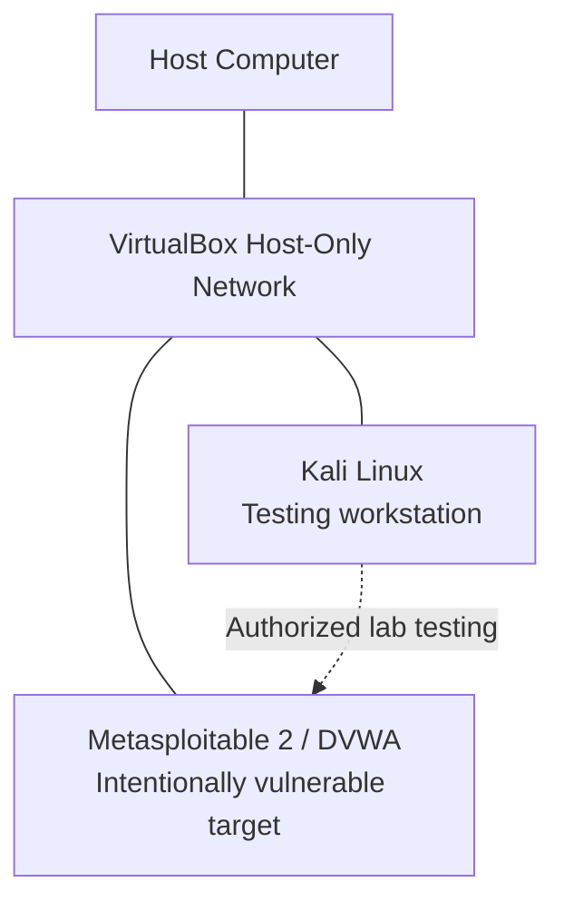

# ApexPlanet Internship — Task 1
## Linux Fundamentals, Networking Basics, Cryptography & Tool Familiarization

> **Project:** Foundations of Cybersecurity  
> **Timeline:** Days 1–12  
> **Author:** RootVector  
> **Lab:** Kali Linux + Metasploitable 2 / DVWA in VirtualBox  
> **Purpose:** Personal learning notes, commands, observations, and evidence for Task 1.

---

## Table of Contents

- [1. Task Overview](#1-task-overview)
- [2. Lab Environment](#2-lab-environment)
- [3. Linux Fundamentals](#3-linux-fundamentals)
- [4. Networking Basics](#4-networking-basics)
- [5. Cryptography Basics](#5-cryptography-basics)
- [6. Tool Familiarization](#6-tool-familiarization)
- [7. Linux Cheat Sheet](#7-linux-cheat-sheet)
- [8. Lab Report and Evidence Checklist](#8-lab-report-and-evidence-checklist)
- [9. What I Learned](#9-what-i-learned)
- [10. Learning Resources](#10-learning-resources)

---

## 1. Task Overview

The goal of this task is to build a foundation before moving into more advanced security testing. I am learning how to work comfortably in Linux, understand how devices communicate, protect information with cryptography, and use common tools to observe and test systems in a controlled lab.

### Topics covered

- Linux file-system navigation, permissions, package management, and networking commands.
- OSI and TCP/IP models, IP addressing, subnetting, NAT, DNS, and HTTP/HTTPS.
- Symmetric and asymmetric encryption, hashing, certificates, and TLS.
- Basic use of Wireshark, Nmap, Burp Suite, and Netcat.
- Lab documentation, screenshots, and a short walkthrough video.

### My learning rule

I will run commands only on my own machine, my own virtual machines, or systems where I have explicit permission. I will record what a command does, what output I observed, and what I learned instead of copying output without understanding it.

---

## 2. Lab Environment

### Lab components

| Component | Role | Notes |
|---|---|---|
| VirtualBox | Virtualization software | Runs the virtual machines |
| Kali Linux | Security-testing workstation | Contains Linux and security tools |
| Metasploitable 2 | Intentionally vulnerable target VM | Lab target only; never expose it to the public internet |
| DVWA | Deliberately vulnerable web application | Useful for learning web security in a controlled environment |
| Wireshark | Packet analyzer | Shows network traffic visible to the capture interface |

### Lab network concept

I use a private Host-Only network so the host and the connected VMs can communicate without making the vulnerable target a public-facing system. VirtualBox network settings can vary, so I verify the actual adapter names and IP addresses rather than assuming a fixed address.



**Important:** Host-Only networking isolates communication to the host and VMs attached to that virtual network, but it does not automatically disable other adapters on every VM. Check each VM's adapter configuration and do not bridge the vulnerable target to a real network.

### Setup checks

On Kali, I can inspect interfaces and addresses with:

```bash
ip addr
ip route
```

To check connectivity to my own lab target:

```bash
ping -c 4 <TARGET_IP>
```

Replace `<TARGET_IP>` with the address shown by the target VM. If the target does not respond, I should check the VM power state, adapter mode, subnet, firewall, and IP address before assuming the target is down.

### Lab screenshots to add

Put screenshots in `screenshots/` and link them here after capturing them:

- `screenshots/kali-desktop.png` — Kali VM running.
- `screenshots/lab-network.png` — VirtualBox network adapter configuration (hide anything private).
- `screenshots/connectivity-test.png` — Successful ping between the lab VMs.
- `screenshots/dvwa-browser.png` — DVWA opened from Kali, with no credentials visible.
- `screenshots/wireshark-test.png` — A small test capture with a filter applied.

Example Markdown image syntax:

```markdown

```

---

# 3. Linux Fundamentals

Linux is widely used on servers and in security testing. The terminal lets me navigate files, inspect permissions, install software, and troubleshoot network connections. Before using a security tool, I need to understand the commands I am running and the permissions they require.

## 3.1 File-system navigation

Linux uses one directory tree that starts at `/`, called the root directory. A path can be **absolute** (starts with `/`) or **relative** (starts from the current directory).

| Command | Meaning | Example |
|---|---|---|
| `pwd` | Print the current working directory | `pwd` |
| `ls` | List directory contents | `ls` |
| `ls -la` | Include hidden files and detailed information | `ls -la` |
| `cd /etc` | Change to `/etc` | `cd /etc` |
| `cd ..` | Move to the parent directory | `cd ..` |
| `cd ~` | Move to the current user's home directory | `cd ~` |
| `mkdir notes` | Create a directory | `mkdir notes` |
| `touch notes.md` | Create an empty file if it does not exist | `touch notes.md` |
| `cat notes.md` | Print a file's contents | `cat notes.md` |
| `less notes.md` | Read a file page by page | `less notes.md` |
| `file notes.md` | Identify a file's type | `file notes.md` |

### What I should remember

- `.` means the current directory.
- `..` means the parent directory.
- A name beginning with `.` is usually hidden from a normal `ls` listing.
- Linux paths are case-sensitive: `Notes.md` and `notes.md` are different names.
- Use `pwd` if I am unsure where I am before creating or changing files.

### Practice

```bash
pwd
ls -la
cd /tmp
pwd
mkdir rv-task1-practice
cd rv-task1-practice
touch first-notes.txt
ls -l
```

I should be able to explain the effect of each line before running it. The practice directory can be removed later if it is no longer needed.

## 3.2 Permissions and ownership

Linux permissions control who can read, write, or execute a file. The three common permission classes are:

- **User (`u`)** — the file's owner.
- **Group (`g`)** — users in the file's group.
- **Others (`o`)** — everyone else.

The permission letters are `r` = read, `w` = write, and `x` = execute.

For a directory, read permission allows listing its entries, execute permission allows traversal/access through it, and write permission allows changing directory entries when combined with the necessary permissions.

Example output:

```text
-rw-r--r-- 1 user user 120 Oct 15 10:00 notes.txt
```

The first character `-` means a regular file. The next three characters `rw-` are the owner's permissions, `r--` are the group's permissions, and the final `r--` are others' permissions.

### `chmod` — change permissions

```bash
chmod u+x script.sh
chmod 640 notes.txt
```

`chmod 640 notes.txt` means owner read/write, group read, and others no permissions. Numeric values are `r = 4`, `w = 2`, and `x = 1`; therefore `7` means `rwx`, `5` means `r-x`, and `6` means `rw-`.

### `chown` — change ownership

```bash
ls -l notes.txt
sudo chown <username>:<groupname> notes.txt
```

Replace the placeholders with real local account and group names. Changing ownership normally requires elevated privileges. I should not run `chown` recursively on system directories unless I fully understand the consequences.

### Inspect permissions

```bash
ls -l
stat notes.txt
```

**Security note:** Do not make files world-writable (`chmod 777`) as a quick fix. Grant only the permissions required for the task.

## 3.3 Package management: `apt` and `dpkg`

Kali is Debian-based. `apt` works with repositories and resolves package dependencies; `dpkg` works directly with local Debian package files and the installed package database.

| Command | Use |
|---|---|
| `sudo apt update` | Refresh package lists; does not upgrade all packages |
| `apt search <name>` | Search package names/descriptions |
| `apt show <name>` | View package information |
| `sudo apt install <name>` | Install a package from configured repositories |
| `sudo apt remove <name>` | Remove a package while generally leaving configuration files |
| `sudo apt autoremove` | Remove dependencies no longer required, after reviewing the list |
| `dpkg -l` | List packages known to dpkg |
| `dpkg -s <name>` | Show status/details of an installed package |
| `dpkg -i <file.deb>` | Install a local `.deb` package; dependencies may need fixing with apt |

### Example workflow

```bash
sudo apt update
apt search wireshark
apt show wireshark
```

Before installing or removing anything, I should read the proposed changes and make sure I am using trusted repositories. Do not paste random commands from websites without understanding them.

## 3.4 Networking commands

### `ip` and `ifconfig`

`ip` is the modern Linux tool for inspecting and managing network interfaces and routes. `ifconfig` is a legacy utility that may not be installed by default.

```bash
ip addr
ip link
ip route
ifconfig
```

I use these to check interface names, whether an interface is up, assigned IP addresses, and the default route. If `ifconfig` is missing, that does not necessarily mean the network is broken; `ip addr` is usually enough for basic inspection.

### `ping`

`ping` sends ICMP Echo Requests and reports replies when the destination and network allow them.

```bash
ping -c 4 127.0.0.1
ping -c 4 <TARGET_IP>
```

`127.0.0.1` is the loopback address of the local machine. A failed ping does not prove that a host is offline: ICMP may be filtered, a route may be missing, or the target may be configured not to reply.

### `netstat` and `ss`

`netstat` is a legacy network-status utility. `ss` is the modern alternative commonly available on Linux.

```bash
ss -tuln
ss -tunap
netstat -tuln
```

- `-t` TCP, `-u` UDP, `-l` listening sockets, `-n` numeric addresses/ports.
- Adding `-p` requests process information and may require elevated privileges.

A listening socket indicates a service is waiting for connections; it does not automatically mean the service is vulnerable.

### `traceroute`

`traceroute` helps show the network hops a packet takes toward a destination. Some routers do not reply, so `*` entries can be normal.

```bash
traceroute <DESTINATION>
```

Use only destinations appropriate for your learning exercise and follow the network owner's rules.

---

# 4. Networking Basics

Networking is how systems exchange data. When I visit a website, my computer may resolve a domain through DNS, establish a transport connection, and exchange HTTP messages with the server. Knowing each layer helps me interpret packet captures and troubleshoot failures.

## 4.1 OSI model

The OSI model divides network communication into seven conceptual layers.

| Layer | Name | Main role | Example |
|---:|---|---|---|
| 7 | Application | Network services used by applications | HTTP, DNS |
| 6 | Presentation | Data representation, encoding, encryption concepts | Data formats, encryption representation |
| 5 | Session | Establishes/manages communication sessions in the model | Session control |
| 4 | Transport | End-to-end transport and port numbers | TCP, UDP |
| 3 | Network | Logical addressing and routing | IP, routers |
| 2 | Data Link | Local-link frames and MAC addressing | Ethernet, switches |
| 1 | Physical | Signals and transmission media | Copper, fiber, radio |

The OSI model is a learning model. Real protocols do not always fit neatly into one layer, but the model gives me a shared vocabulary for troubleshooting.

## 4.2 TCP/IP model

| TCP/IP layer | Examples | Similar OSI layers |
|---|---|---|
| Application | HTTP, HTTPS, DNS, SSH | 5–7 |
| Transport | TCP, UDP | 4 |
| Internet | IPv4, IPv6, ICMP | 3 |
| Link / Network access | Ethernet, Wi-Fi, ARP concepts | 1–2 |

A useful troubleshooting habit is to move from the local link and IP configuration upward: check the interface, IP address, route, name resolution, transport connection, and finally the application.

## 4.3 TCP and UDP

**TCP** is connection-oriented and provides ordered, reliable byte-stream delivery. It uses acknowledgements and retransmission to handle loss. Applications such as SSH and many web connections commonly use TCP.

**UDP** sends independent datagrams without TCP's built-in delivery and ordering guarantees. It has lower protocol overhead and is used by services such as many DNS queries and real-time applications.

| Feature | TCP | UDP |
|---|---|---|
| Connection setup | Yes | No TCP-style handshake |
| Delivery/order guarantees | Built in | Not built in |
| Data model | Byte stream | Datagrams |
| Common examples | HTTPS over TCP, SSH | DNS queries, voice/video traffic |

Some modern protocols, including HTTP/3, use QUIC over UDP, so “all web traffic uses TCP” is not correct.

### Ports

A port number helps the operating system deliver transport traffic to the appropriate service. Common examples include TCP 22 for SSH, TCP 80 for HTTP, and TCP 443 for HTTPS. These are conventions, not proof that a particular service is actually running on that port.

## 4.4 IP addressing, subnetting, and NAT

An IP address identifies an interface at the IP layer. IPv4 addresses are 32 bits, usually written as four decimal octets, such as `192.168.56.10`. IPv6 uses 128 bits and is written in hexadecimal groups.

### Private IPv4 ranges

- `10.0.0.0/8`
- `172.16.0.0/12`
- `192.168.0.0/16`

These ranges are intended for private networks and are not globally routed on the public internet. A private address can still be reachable from other networks through routing, VPNs, or other configurations, so private does not mean automatically secure.

### CIDR and subnet masks

CIDR notation such as `/24` says how many leading bits are the network prefix. A typical `/24` IPv4 subnet has mask `255.255.255.0` and 256 total addresses; in a traditional subnet, 254 are usable host addresses because the network and broadcast addresses are reserved.

For example, `192.168.56.10/24` and `192.168.56.20/24` are in the same `192.168.56.0/24` subnet. Whether they can communicate still depends on interface configuration, routing, and filtering.

### NAT

Network Address Translation modifies IP addresses (and often transport ports) as traffic passes through a router. Home routers commonly use NAT so multiple private devices can share one public IPv4 address. NAT is not a substitute for a firewall or secure service configuration.

### Inspect the local network

```bash
ip addr
ip route
```

Record the IP address and subnet of each lab VM. Avoid assuming that an address will always be assigned; DHCP and VirtualBox settings can change it.

## 4.5 DNS

The Domain Name System maps domain names to records such as IP addresses. A browser commonly needs DNS resolution before it can connect to a named website.

Useful record types:

- **A:** IPv4 address.
- **AAAA:** IPv6 address.
- **CNAME:** Alias to another domain name.
- **MX:** Mail exchanger.
- **NS:** Authoritative name server.
- **TXT:** Text data used for multiple purposes, including domain verification and email security policies.

### Basic DNS checks

```bash
nslookup example.com
```

If `dig` is installed:

```bash
dig example.com A
dig example.com AAAA
dig example.com MX
```

DNS resolution and website connectivity are different checks. A name can resolve successfully while the web server is unreachable, and a server can be reachable by IP even if DNS is misconfigured.

## 4.6 HTTP and HTTPS

HTTP is an application-layer protocol for requests and responses. A request commonly contains a method, path, headers, and sometimes a body. A response contains a status code, headers, and optionally a body.

Common methods:

- `GET` — retrieve a representation.
- `POST` — submit data or request an action.
- `PUT` — create or replace a resource, depending on the API.
- `DELETE` — request deletion of a resource.

Common status codes:

- `200 OK` — request succeeded.
- `301` / `302` — redirect.
- `400 Bad Request` — request was invalid.
- `401 Unauthorized` — authentication is required or failed.
- `403 Forbidden` — server refuses the request.
- `404 Not Found` — requested resource was not found.
- `500 Internal Server Error` — server encountered an error.

### HTTPS and TLS

HTTPS is HTTP protected by TLS. TLS helps provide confidentiality, integrity, and server authentication when correctly configured and certificate validation succeeds. HTTPS does not guarantee that a website is trustworthy or that its application is free of vulnerabilities.

A browser validates a certificate chain, checks the hostname and validity period, and negotiates cryptographic parameters. A certificate warning should not be ignored for real accounts or sensitive data.

---

# 5. Cryptography Basics

Cryptography protects information and helps establish trust. The key concepts are encryption (reversible with the appropriate key), hashing (one-way digest), and digital signatures/certificates (integrity, authenticity, and identity verification).

## 5.1 Encryption vs hashing

| Property | Encryption | Hashing |
|---|---|---|
| Purpose | Keep data confidential | Produce a digest for comparison/integrity |
| Reversible? | Yes, with the correct key and algorithm | Designed to be one-way |
| Key required? | Usually yes | Ordinary hash functions do not require a secret key |
| Example | AES encryption | SHA-256 digest |

A hash is not encryption: there is no decryption key that turns a SHA-256 digest back into the original message. For passwords, modern systems should use dedicated password-hashing functions such as Argon2id, scrypt, bcrypt, or PBKDF2 with salts and suitable parameters—not plain MD5 or SHA-256 alone.

## 5.2 Symmetric and asymmetric encryption

### Symmetric encryption

The same secret key is used to encrypt and decrypt. It is efficient for large amounts of data, but both parties need a safe way to obtain and protect the key.

Examples include AES. The mode and configuration matter; for new applications, authenticated encryption such as AES-GCM is generally preferable to unauthenticated encryption modes.

### Asymmetric cryptography

Asymmetric systems use a related public/private key pair. The public key can be shared; the private key must be protected.

Public-key cryptography supports digital signatures and key establishment. Some algorithms also support encryption, but modern secure connections often use public-key techniques to authenticate and establish shared secrets, then use symmetric cryptography for bulk data.

| Symmetric | Asymmetric |
|---|---|
| One shared secret key | Public and private key pair |
| Fast for bulk data | Usually more computationally expensive |
| Key distribution is a challenge | Public key can be distributed, but identity must be verified |
| Example: AES | Examples: RSA, elliptic-curve cryptography |

## 5.3 MD5 and SHA-256

A cryptographic hash maps input data of arbitrary length to a fixed-length digest.

- **MD5:** 128-bit digest; collisions can be deliberately constructed. Do not use it for security-sensitive integrity or signatures.
- **SHA-256:** 256-bit digest from the SHA-2 family; widely used for integrity checks and as part of modern cryptographic systems.

A matching digest can help detect accidental or malicious file changes, assuming the reference digest itself is trustworthy. A hash by itself does not prove who created a file.

### Calculate file hashes

```bash
md5sum filename.txt
sha256sum filename.txt
```

After editing the file, calculate the digest again and compare it with the original. A changed file should normally produce a different digest.

## 5.4 Digital certificates and TLS

A digital certificate binds an identity (such as a DNS hostname) to a public key and is signed by a certificate authority or another trusted issuer. Browsers use a trust store and certificate validation rules to decide whether to trust a certificate for a hostname.

Key terms:

- **Certificate Authority (CA):** Issues or signs certificates.
- **Public key:** Can be shared.
- **Private key:** Must remain secret.
- **Certificate chain:** Links a server certificate to a trusted root through intermediate certificates.
- **TLS:** Provides protected communication after a handshake negotiates parameters and establishes keys.
- **Certificate validation:** Includes checks such as hostname, validity period, and trust chain.

TLS protects data in transit between endpoints. It does not stop a compromised endpoint from exposing data, nor does it fix insecure application logic.

## 5.5 OpenSSL practical

OpenSSL is a command-line toolkit for cryptographic operations and TLS-related tasks. These examples are for local practice files.

### A. Create a sample message

```bash
printf '%s' 'RootVector Task 1 practice message' > message.txt
```

### B. Encrypt with AES-256-CBC

```bash
openssl enc -aes-256-cbc -salt -pbkdf2 -in message.txt -out message.enc
```

OpenSSL prompts for a passphrase. Use a practice passphrase that is not used for any real account.

### C. Decrypt the file

```bash
openssl enc -d -aes-256-cbc -pbkdf2 -in message.enc -out message-decrypted.txt
cat message-decrypted.txt
```

The decrypted output should match the original message if the correct passphrase and parameters are used. This example demonstrates the workflow; AES-CBC does not authenticate the ciphertext. For production systems, use a well-reviewed authenticated-encryption design rather than building your own format.

### D. Calculate a SHA-256 digest

```bash
openssl dgst -sha256 message.txt
```

### E. Inspect a public TLS endpoint (optional)

Only query a service you are permitted to inspect:

```bash
openssl s_client -connect example.com:443 -servername example.com
```

This can show certificate and handshake information. Press `Ctrl+C` to exit. Output depends on the remote server and installed OpenSSL version.

---

# 6. Tool Familiarization

These tools have different purposes: Wireshark observes packets, Nmap discovers hosts and services, Burp Suite helps inspect web requests, and Netcat can test simple TCP/UDP connections. I use them only against my lab or an explicitly authorized target.

## 6.1 Wireshark


Wireshark captures and displays packets visible to the selected network interface. It helps me learn protocol structure and investigate unexpected network behavior.

### Basic workflow

1. Start Wireshark.
2. Choose the interface connected to the lab network.
3. Start a capture.
4. Generate a small amount of test traffic, such as pinging my lab VM.
5. Stop the capture and apply a display filter.

Useful display filters:

```text
icmp
dns
tcp
http
ip.addr == <TARGET_IP>
tcp.port == 80
```

Display filters change which captured packets are shown; they do not change the packets already captured.

### What to look for

- Source and destination addresses.
- Protocol and transport ports.
- ICMP Echo Request and Reply packets during ping.
- DNS queries and responses.
- TCP connection setup and teardown.
- HTTP headers when using a deliberately unencrypted lab service.

**Privacy note:** Packet captures can contain sensitive data. Do not publish captures containing passwords, cookies, tokens, personal data, or traffic from networks you do not own. HTTPS application contents are generally encrypted in transit, though metadata may still be visible.

## 6.2 Nmap


Nmap discovers hosts and examines ports and services. A scan result is a point-in-time observation, not proof that a system is secure or vulnerable.

### Start with a single lab target

```bash
nmap <TARGET_IP>
```

Service/version detection on the authorized target:

```bash
nmap -sV <TARGET_IP>
```

A scan of a host in my isolated lab is a good place to learn what the output means. Review the port state (`open`, `closed`, or `filtered`), detected service, and any uncertainty in version identification.

### Save output for a lab report

```bash
mkdir -p reports
nmap -sV -oN reports/nmap-lab.txt <TARGET_IP>
```

Keep reports limited to authorized systems and review them before publishing to make sure they do not reveal sensitive information.

## 6.3 Burp Suite


Burp Suite is a web application testing platform. Its proxy can sit between a browser and a web application so I can inspect HTTP requests and responses in a controlled lab.

### Basic learning workflow

1. Open Burp Suite.
2. Use its built-in browser or configure a dedicated test browser to use the local proxy.
3. Visit the lab application, such as DVWA, from that browser.
4. Open **Proxy → HTTP history** to inspect requests.
5. Select a request to review its method, path, headers, parameters, and response.
6. Use **Repeater** to resend and manually change a request in the lab.

The exact interface can vary by Burp version. Keep lab proxy configuration separate from normal browsing. Do not install Burp's CA certificate into a general-purpose browser profile unless you understand the implications.

## 6.4 Netcat

Netcat (`nc`) is a small utility for reading and writing data over network connections. It is useful for basic connectivity checks and understanding TCP/UDP behavior.

### Check a lab service's TCP port

```bash
nc -vz <TARGET_IP> 80
```

This attempts a TCP connection to port 80 and reports whether the connection succeeds. It does not prove that the HTTP application is secure.

### Send a simple HTTP request to a lab web server

```bash
printf 'HEAD / HTTP/1.0\r\nHost: <TARGET_IP>\r\n\r\n' | nc -nv <TARGET_IP> 80
```

This sends a basic HTTP request to a target in the lab. A server may close the connection or respond differently depending on its configuration.

**Safety:** Netcat can also be used to create listeners and transfer data. For this task, stick to connectivity checks and benign protocol demonstrations on your own lab network.

---

# 7. Linux Cheat Sheet

| Goal | Command |
|---|---|
| Show current directory | `pwd` |
| List files, including hidden files | `ls -la` |
| Change directory | `cd /path/to/dir` |
| Go to parent directory | `cd ..` |
| Create directory | `mkdir notes` |
| Read a file | `less notes.md` |
| Inspect permissions | `ls -l filename` |
| Change file mode | `chmod 640 filename` |
| Change file owner | `sudo chown user:group filename` |
| Refresh package lists | `sudo apt update` |
| Search packages | `apt search name` |
| List IP addresses | `ip addr` |
| Show routes | `ip route` |
| Test ICMP reachability | `ping -c 4 <TARGET_IP>` |
| Show listening TCP/UDP sockets | `ss -tuln` |
| Trace network hops | `traceroute <DESTINATION>` |
| Resolve a DNS name | `nslookup example.com` |
| Calculate SHA-256 | `sha256sum filename` |

---

# 8. Lab Report and Evidence Checklist

The internship brief asks for a lab setup report, a GitHub repository with notes and a Linux cheat sheet, and a five-minute lab walkthrough video.

## Suggested folder layout

```text
Task-01/
├── README.md
├── notes/
│   ├── linux-fundamentals.md
│   ├── networking-basics.md
│   └── cryptography-basics.md
├── reports/
│   ├── lab-setup-report.md
│   └── nmap-lab.txt
├── screenshots/
│   ├── kali-desktop.png
│   ├── lab-network.png
│   ├── connectivity-test.png
│   ├── dvwa-browser.png
│   └── wireshark-test.png
└── captures/
    └── README.md
```

Only add files that I have actually created. Do not add fake screenshots or claim tests succeeded unless I observed the result.

## Lab setup report template

### Objective
Set up an isolated virtual environment for introductory cybersecurity practice.

### Environment
- Host operating system: `[fill in]`
- Virtualization software/version: `[fill in]`
- Kali Linux version: `[fill in]`
- Target VM/application: `[fill in]`
- Lab network mode: `[fill in]`

### Steps performed
1. Installed and started the virtual machines.
2. Checked each VM's network adapter configuration.
3. Recorded the IP addresses from the running VMs.
4. Tested connectivity between the Kali VM and the target.
5. Opened the lab web application, if configured.
6. Captured a small test trace in Wireshark.

### Results
- Kali IP address: `[fill in from actual output]`
- Target IP address: `[fill in from actual output]`
- Ping result: `[success/failure + brief observation]`
- Web application access: `[observed result]`
- Wireshark observation: `[protocol/filter and what I saw]`

### Issues and fixes
Write down the actual problem, what I checked, what change I made, and the result. Do not present a guess as a confirmed root cause.

### Conclusion
Summarize what worked, what I learned, and what remains to be completed.

## Before publishing

- [ ] Remove passwords, access tokens, cookies, private keys, and personal data from screenshots and captures.
- [ ] Confirm the repository contains only files intended to be public.
- [ ] Test every Markdown link and image path.
- [ ] Add desktop and lab screenshots that I actually captured.
- [ ] Record a short walkthrough showing the environment, network setup, and one harmless connectivity/packet-capture demonstration.
- [ ] Check the internship submission instructions and include the required GitHub and video links.

---

# 9. What I Learned

Update these notes after completing each practical exercise.

- **Linux:** I practised moving through directories, reading files, inspecting permissions, and understanding package commands.
- **Networking:** I learned how IP addresses, ports, DNS, TCP/UDP, and HTTP/HTTPS fit together.
- **Cryptography:** I distinguished encryption from hashing and practised encrypting/decrypting a sample file with OpenSSL.
- **Tools:** I used Wireshark to inspect packets, Nmap to examine my lab target, Burp Suite to view web requests, and Netcat to test a lab service.
- **Responsible practice:** I kept testing inside my own lab and documented the actual evidence instead of making assumptions.

> **Personal progress note:** Replace or expand these statements with the commands I actually ran, the output I observed, and one thing I found confusing. This keeps the README honest and useful as revision material.

---

# 10. Learning Resources

These are official documentation or established learning resources used to study the topics. Some pages may be updated over time.

## Linux
- [Kali Linux Documentation](https://www.kali.org/docs/)
- [Debian Reference](https://www.debian.org/doc/manuals/debian-reference/)
- [GNU Coreutils Manual](https://www.gnu.org/software/coreutils/manual/)
- [Linux `chmod` manual](https://man7.org/linux/man-pages/man1/chmod.1.html)
- [Linux `chown` manual](https://man7.org/linux/man-pages/man1/chown.1.html)
- [APT documentation](https://manpages.debian.org/apt/apt.8.en.html)

## Virtual lab
- [Oracle VirtualBox User Manual](https://www.virtualbox.org/manual/)
- [Kali Linux Downloads and Documentation](https://www.kali.org/get-kali/)
- [Rapid7 Metasploitable 2](https://docs.rapid7.com/metasploit/metasploitable-2/)
- [DVWA project (GitHub)](https://github.com/digininja/DVWA)

## Networking
- [Cloudflare Learning Center](https://www.cloudflare.com/learning/)
- [RFC 791 — Internet Protocol (IPv4)](https://www.rfc-editor.org/rfc/rfc791)
- [RFC 8200 — Internet Protocol, Version 6 (IPv6)](https://www.rfc-editor.org/rfc/rfc8200)
- [RFC 1034 — Domain Names: Concepts and Facilities](https://www.rfc-editor.org/rfc/rfc1034)
- [RFC 9110 — HTTP Semantics](https://www.rfc-editor.org/rfc/rfc9110)

## Cryptography and TLS
- [OpenSSL Documentation](https://docs.openssl.org/)
- [NIST Secure Hash Standard (FIPS 180-4)](https://csrc.nist.gov/pubs/fips/180-4/upd1/final)
- [OWASP Cryptographic Storage Cheat Sheet](https://cheatsheetseries.owasp.org/cheatsheets/Cryptographic_Storage_Cheat_Sheet.html)
- [RFC 8446 — TLS 1.3](https://www.rfc-editor.org/rfc/rfc8446)

## Tools
- [Wireshark User's Guide](https://www.wireshark.org/docs/wsug_html_chunked/)
- [Nmap Reference Guide](https://nmap.org/book/man.html)
- [PortSwigger Web Security Academy](https://portswigger.net/web-security)
- [Netcat manual page](https://manpages.debian.org/netcat-openbsd/nc.1.en.html)

## Internship brief
- [ApexPlanet official website](https://apexplanet.in/)

---

**Status:** Living notes — update this file as I complete the practical work and capture evidence.  
**Repository:** [rootvector-security](https://github.com/rootvector/rootvector-security)  
**Brand:** RootVector
**Name:** Rohan Kakde

*Note: I used ChatGPT to identify reliable, official resources for learning and reference. Since I already have a good understanding of cybersecurity and ethical hacking, and have previously prepared handwritten notes on these topics, I was able to complete this task efficiently without spending too much time on the fundamentals.*

